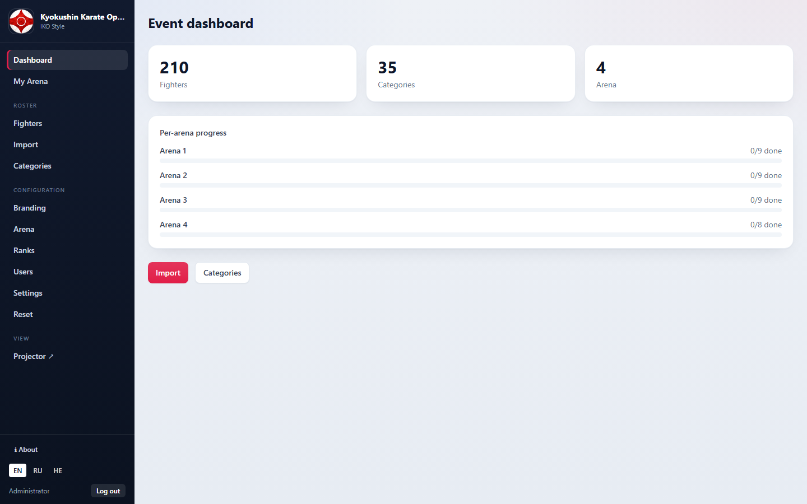
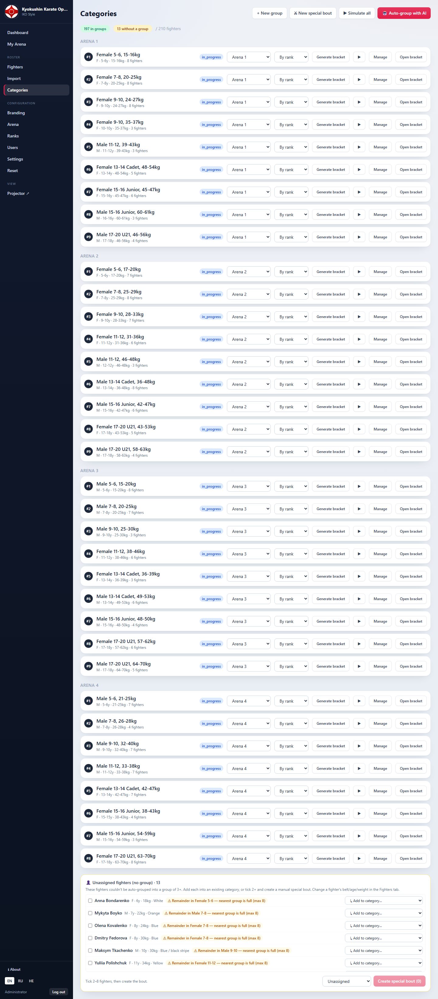
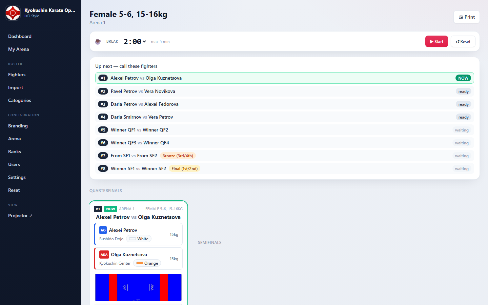
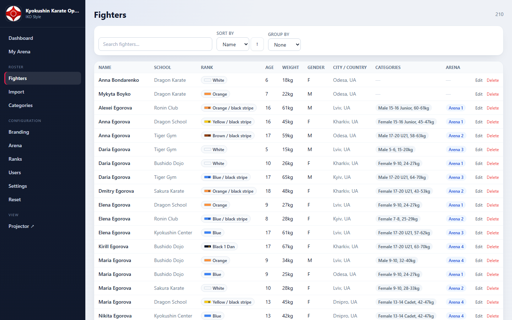
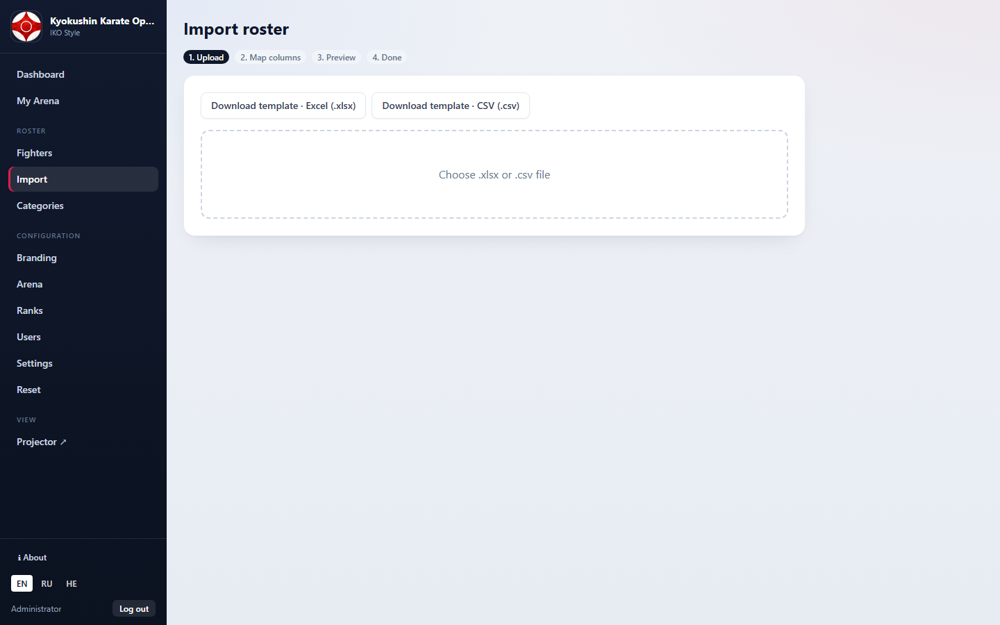
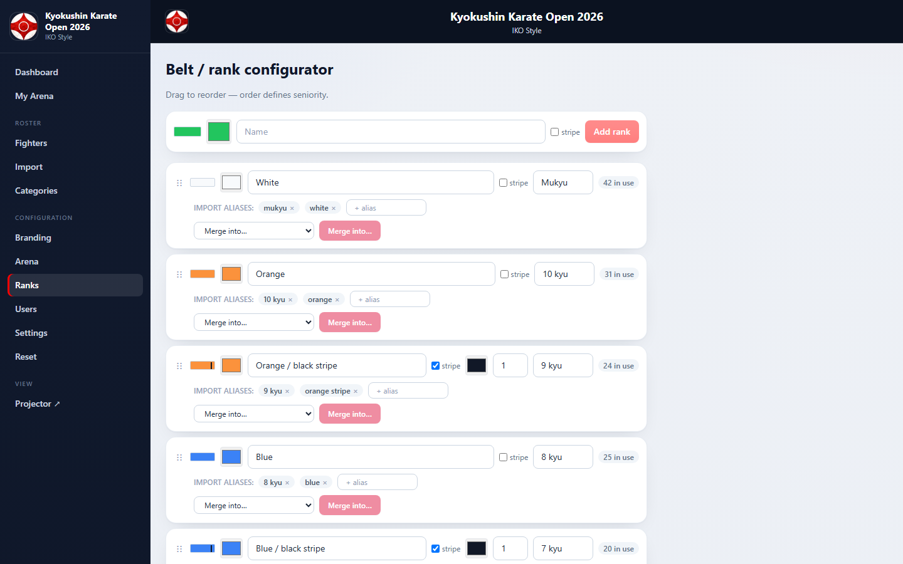
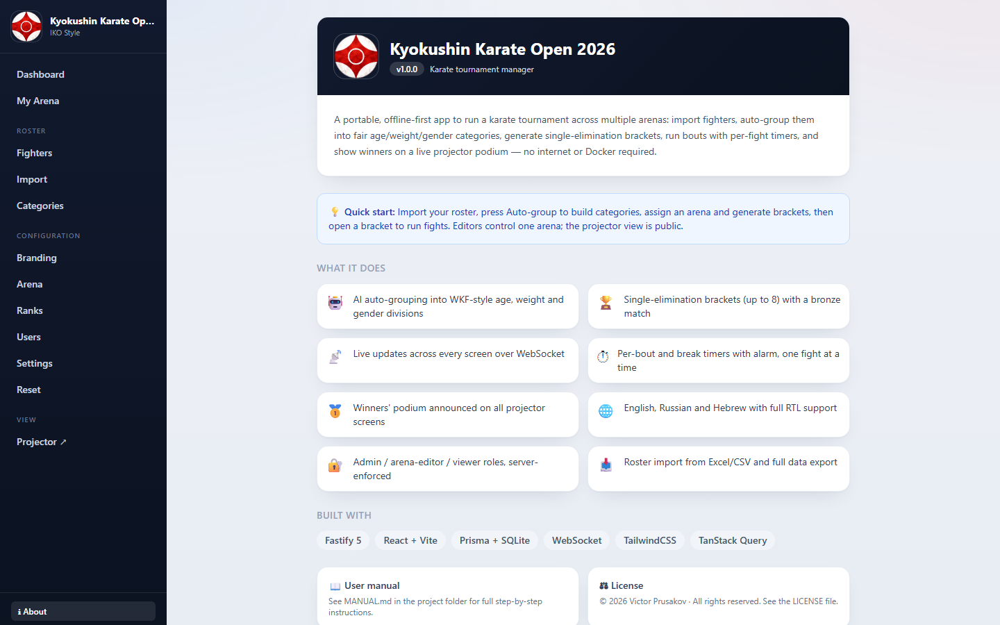
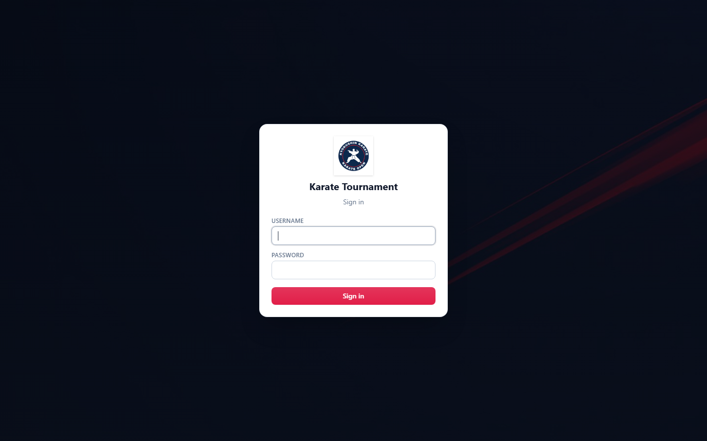

# 🥋 Karate Tournament (Tatami) Management App

A portable, **offline-first** web app to run a karate tournament across multiple
tatami (mats). Import fighters, auto-group them into fair age / weight / gender
categories, generate single-elimination brackets, run bouts with live timers, and
show winners on a projector podium — **no internet and no Docker required**.

Built with **Fastify + WebSocket**, **React + Vite + TailwindCSS**, and
**Prisma on SQLite**. The database and uploads live inside the project folder, so
you can copy the whole folder to any machine with Node.js and it just runs.

---

## ⚡ Quick start (Windows)

1. Install **[Node.js 20+](https://nodejs.org)**.
2. Double-click **`install.bat`** (or run `install.ps1`).
   Add demo data with `install.bat demo`.
3. When it finishes, start the app:
   - **Development:** `npm run dev` → open http://localhost:5173
   - **Production:** `npm run serve` → open http://localhost (port 80; run the
     terminal as Administrator)
4. Log in with the **admin credentials printed during installation**.

> The installer creates `server\.env` with a unique JWT secret, sets up the SQLite
> database, seeds the first admin, and builds the app.

### Manual install (any OS)

```bash
npm install
npm run prisma:generate
npm run prisma:push
npm run seed          # or: npm run seed:demo
npm run build
npm run dev           # or: npm run serve   (production, port 80)
```

---

## 📸 Screenshots

| | |
|---|---|
| **Dashboard** | **Categories / auto-grouping** |
|  |  |
| **Live bracket (one fight at a time, timers)** | **Fighters** |
|  |  |
| **Import roster** | **Belts / ranks** |
|  |  |
| **About** | **Login** |
|  |  |

More in [`docs/screenshots/`](docs/screenshots/) (branding, projector, …).

## 📖 Documentation

- **[MANUAL.md](MANUAL.md)** — full step-by-step user guide (setup → running fights → podium).
- **[LICENSE](LICENSE)** — usage terms.
- In the app: the **ℹ About** button (bottom of the sidebar) summarises features and links here.

---

## 🚚 Moving to another computer

The app is fully portable:

1. Copy the entire project folder (it contains `data/karate.sqlite` and `uploads/`).
2. On the new machine (Node 20+): `npm install` then `npm run build`.
3. `npm run serve` (or `npm run dev`).

No database server, no containers — everything travels in the folder.

---

## 🔐 Publishing to a private Git repository

Run **`publish-to-github.bat`** (or `publish-to-github.ps1`). It initialises git,
verifies that secrets (`.env`) and local data are never committed, and creates a
**private** GitHub repo via the GitHub CLI. No CLI? Create an empty private repo on
github.com and pass its URL:

```powershell
.\publish-to-github.ps1 -RemoteUrl https://github.com/<you>/karate-tournament.git
```

---

## 🛠️ Useful scripts

| Command | What it does |
|---|---|
| `npm run dev` | Run backend + frontend with hot reload (ports 4000 / 5173) |
| `npm run serve` | Build and serve the whole app on port 80 |
| `npm run build` | Build the client and compile the server |
| `npm run seed` | Seed the first admin, default ranks and event |
| `npm run seed:demo` | Same, plus 200 synthetic demo fighters |
| `npm test` | Run the backend test suite |
| `npm run prisma:push` | Sync the SQLite schema |

---

© 2026 Victor Prusakov. See [LICENSE](LICENSE).
